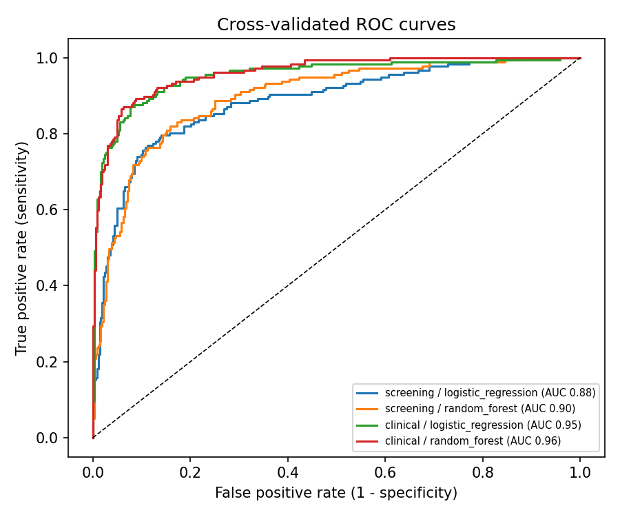

# 🌸 HerHealth AI: PCOS screening with no blood test needed

> Built at the **Leeds AI Society AI in Healthcare Hackathon** (24–25 Oct 2026, Helix, University of Leeds).

**Up to 70% of women with polycystic ovary syndrome (PCOS) are estimated to be undiagnosed** (WHO estimate, as reported by ACP Internist, 2024). Symptoms like irregular periods, acne, excess hair growth and weight gain are often dismissed or treated one at a time, so the pattern gets missed.

**HerHealth AI** lets anyone check, in two minutes and privately, whether their symptoms share patterns with PCOS, using **only things they already know about themselves**. It then gives them a plain-English summary and specific questions to take to their GP.

> ⚠️ This is a screening and education tool, **not a diagnosis**. It cannot rule PCOS in or out.

---

## What it does

- **💬 Chat:** describe your symptoms in your own words. An LLM (OpenAI) turns your description into structured answers and asks follow-up questions for anything missing.
- **📝 Quick check:** the same model through a simple form, with **no AI and no data leaving the app**.
- **Result:** a screening score, the answers that influenced it most, a plain-English explanation, and questions to ask your GP.
- **Safety:** red-flag symptoms (severe pain, very heavy bleeding, fainting, pregnancy with bleeding) trigger urgent-care advice straight away.

<!-- TODO: add 2-3 screenshots here (chat, result, quick check) -->

## How it works

```
User text ──► LLM extracts structured answers (JSON schema, strict) ──► follow-up questions
                                   │
                                   ▼
             scikit-learn model trained on a public dataset ──► screening score
                                   │      + per-person factors (what moved the score)
                                   ▼
             LLM explains in plain English + GP questions ──► guardrails ──► user
```

**Key design decision: the LLM never makes the prediction.** LLM outputs can't be validated and can be confidently wrong. A small, transparent ML model does the prediction and is evaluated with cross-validation. The LLM is only the *interface*: it understands free text and explains the result kindly.

### Two models
| Model | Inputs | Purpose |
|---|---|---|
| **Screening** (used in the app) | 11 self-reportable answers: age, BMI, cycle regularity, period length, weight gain, excess hair growth, skin darkening, hair loss, acne, fast food, exercise | Works for anyone, with no tests |
| **Clinical** (comparison) | Screening inputs + hormone blood tests + ultrasound follicle counts | Shows how much the lab tests add |

The self-reported inputs map onto two of the three internationally used (Rotterdam) criteria for PCOS: irregular cycles and signs of excess androgens.

### Evaluation
- 5-fold **stratified cross-validation** (small dataset, so no single lucky split)
- Logistic regression vs random forest, with the best chosen by **ROC-AUC**
- The decision threshold is tuned for **high sensitivity (≥ 85%)**, because a screening tool should rarely miss a case
- Reported: sensitivity, specificity, PPV, NPV, plus a **bias check by age group and BMI band**
- Full results: [`reports/model_card.md`](reports/model_card.md) and [`reports/figures/`](reports/figures)

### Results (541 patients, 177 with PCOS; 5-fold cross-validation)

| Model | Inputs | AUC | Sensitivity | Specificity |
|---|---|---|---|---|
| **Screening** (in the app) | 11 self-reported answers, **no tests** | **0.90** | **86%** | 76% |
| Clinical (comparison) | + hormone blood tests + ultrasound | 0.96 | 86% | 94% |

**Key finding: answers a woman already knows recover most of the signal** (AUC 0.90 vs 0.96 with blood tests and scans). The strongest self-reported signals were darkened skin patches, excess hair growth, unexplained weight gain and irregular periods.



## Responsible use of data

See **[`RESPONSIBLE_DATA.md`](RESPONSIBLE_DATA.md)**. In short:
- **Open public dataset only** (Kaggle, CC BY-NC-SA 4.0). We collected no patient data, and our pipeline drops the only identifier-like column (hospital file numbers).
- **Nothing users enter is stored.** Obvious identifiers are scrubbed before any text is sent to the OpenAI API, and the form mode uses no external API at all.
- **Bias and limitations are measured and stated:** the data comes from one region, it's a small sample, and the scores aren't calibrated probabilities.

## Run it locally

```bash
git clone <this repo> && cd herhealth-ai
python -m venv .venv && source .venv/bin/activate    # Windows: .venv\Scripts\activate
pip install -r requirements.txt

# 1. Get the data (see data/README.md), then train
python -m src.train --data data/raw/PCOS_data_without_infertility.xlsx

# 2. (Optional) enable the AI chat
cp .env.example .env        # then paste your OpenAI key into .env (never commit it)

# 3. Run the app
streamlit run app.py
```

No data yet? `python scripts/make_synthetic_data.py`, then train on `data/synthetic/pcos_synthetic.csv`. The app will clearly show **"Demo mode: synthetic data"**.

Tests: `pytest -q`

## Deploy (Streamlit Community Cloud)
1. Push this repo to GitHub, **public**, *including* `models/pcos_screening.joblib`.
2. On share.streamlit.io, choose **New app**, pick the repo, and set the main file to `app.py`.
3. In **Advanced settings → Secrets**, add your LLM provider. Any OpenAI-compatible API works. For example, with Groq's free tier:
   ```toml
   OPENAI_API_KEY = "your-groq-key"
   OPENAI_BASE_URL = "https://api.groq.com/openai/v1"
   OPENAI_MODEL = "openai/gpt-oss-120b"
   ```
   See `.env.example` for Gemini and OpenAI settings.

## Repo structure
```
app.py                  Streamlit app (chat + quick check)
src/config.py           feature definitions and questions
src/data.py             loading/cleaning the Kaggle file
src/train.py            cross-validated training, threshold, bias check, model card, figures
src/predict.py          scoring + per-person explanations
src/llm.py              OpenAI extraction (strict JSON schema) and explanations, with offline fallback
src/guardrails.py       red flags, PII scrubbing, no-diagnosis wording, disclaimer
scripts/make_synthetic_data.py   synthetic test data (same columns as the real file)
tests/test_pipeline.py  end-to-end tests
reports/                metrics.json, model_card.md, figures
```

## Tech
Python · pandas · scikit-learn · Streamlit · OpenAI API (structured outputs) · matplotlib · pytest

## Limitations and next steps
- The training data is small and from a single region, so the next step is validating on more diverse data.
- Scores show similarity to diagnosed cases. They aren't calibrated probabilities of having PCOS.
- Next: co-design with patients and GPs, add other under-diagnosed conditions (e.g. endometriosis, where UK diagnosis takes **8 years 10 months** on average, per Endometriosis UK, 2024), and multilingual support.

## Team
<!-- TODO: list every teammate (name + GitHub) and add them as repo collaborators -->
- Salma Bushra Islam
- Hareem Ghouri
- Ching Kiu Chan
- Jinesh Dugar

## Disclosure of AI tools
Per the hackathon rules: parts of this code and documentation were drafted with the help of AI assistants (Anthropic's Claude), then reviewed, run and tested by the team. The app itself calls the OpenAI API at runtime for the chat features.

## Data credit and licence
Prasoon Kottarathil, *Polycystic ovary syndrome (PCOS)*, Kaggle (2020):
https://www.kaggle.com/datasets/prasoonkottarathil/polycystic-ovary-syndrome-pcos.
It was collected from 10 hospitals across Kerala, India.

The data is licensed **[CC BY-NC-SA 4.0](https://creativecommons.org/licenses/by-nc-sa/4.0/)**, and the original file is included unmodified in `data/raw/`. The trained models are derived from it, so they are for **non-commercial use only** and are shared under the same licence. See [`data/raw/ATTRIBUTION.md`](data/raw/ATTRIBUTION.md).
